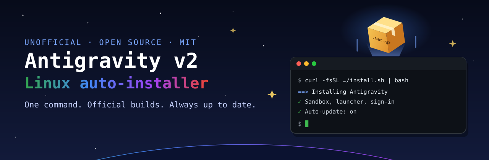

<p align="center">
  
</p>

<p align="center">
  <a href="https://github.com/PierreBultez/antigravity-v2-linux-autoinstaller/actions/workflows/ci.yml"></a>
  <a href="https://github.com/PierreBultez/antigravity-v2-linux-autoinstaller/actions/workflows/live-check.yml"></a>
  
  <a href="LICENSE"></a>
  <br>
  
  
  
  
  
  <a href="https://github.com/PierreBultez/antigravity-v2-linux-autoinstaller/stargazers"></a>
</p>

Install **Google Antigravity 2.0** on Linux with one command (plus **Antigravity IDE** and the **Antigravity CLI** if you want them), then keep it up to date.

Google only ships Antigravity 2.x for Linux as `.tar.gz` archives: no `.deb`, no APT repository, no launcher, no updates. This script fills that gap. It downloads the official archives from [antigravity.google/download](https://antigravity.google/download) and sets everything up so the app behaves like any other installed app.

```bash
curl -fsSL https://raw.githubusercontent.com/PierreBultez/antigravity-v2-linux-autoinstaller/main/install.sh | bash
```

> [!NOTE]
> Unofficial project, not affiliated with or endorsed by Google. Antigravity is a Google product under Google's terms. This repository contains no Google code or assets: the script only downloads Google's own archives.

## ✨ What it does

- 🔎 **Finds the latest official release** on Google's download page, for x86_64 or arm64.
- 🔒 **Downloads safely**: HTTPS only, from Google hosts only (`storage.googleapis.com`, `*.gvt1.com`, `dl.google.com`), and archives with unsafe paths are rejected.
- 📦 **Installs into `/opt`** (for all users) or **`~/.local`** (just you, no sudo).
- 🛟 **Never breaks a working app**: a new version is swapped in only after it is fully downloaded and unpacked.
- 🚀 **Feels native**: app-menu launcher, official icon, `antigravity` / `antigravity-ide` commands.
- 🔑 **Sign-in just works**: registers the `antigravity://` link, so a Google sign-in done in the browser comes back to the app.
- 🧱 **Keeps the sandbox on**: on Ubuntu 23.10+ (which restricts user namespaces) it installs an AppArmor profile, like VS Code and Chrome do, instead of running the app without a sandbox.
- 🔄 **Updates** on request, or daily through a systemd timer. Updates wait while the app is open.
- 🧹 **Uninstalls cleanly**, and keeps your settings unless you ask for `--purge`.
- 🤝 **Plays nice**: compatibility checks find files that would conflict with it and offer to clean them up.
- 🐧 **No `apt` needed**: works on any distribution, not just Debian and Ubuntu.

## 🚀 Usage

```bash
# Antigravity 2.0 desktop app, for all users (asks for sudo once)
curl -fsSL https://raw.githubusercontent.com/PierreBultez/antigravity-v2-linux-autoinstaller/main/install.sh | bash

# Desktop app + IDE
curl -fsSL https://raw.githubusercontent.com/PierreBultez/antigravity-v2-linux-autoinstaller/main/install.sh | bash -s -- install all

# Only for you, in ~/.local, without sudo
curl -fsSL https://raw.githubusercontent.com/PierreBultez/antigravity-v2-linux-autoinstaller/main/install.sh | bash -s -- --user
```

The first install also adds an `antigravity-installer` command:

| Command | What it does |
| --- | --- |
| `antigravity-installer update` | Update everything that is installed |
| `antigravity-installer status` | Installed versions, and whether an update is out |
| `antigravity-installer auto-update on` | Check for updates every day (`off` to stop) |
| `antigravity-installer install ide` | Add Antigravity IDE |
| `antigravity-installer install cli` | Add the Antigravity CLI (runs Google's own CLI installer) |
| `antigravity-installer check` | Print the latest official download URLs, install nothing |
| `antigravity-installer uninstall` | Remove everything (`uninstall ide` for just one; `--purge` also deletes settings and sign-in) |
| `antigravity-installer fix-sandbox` | Reinstall the AppArmor profile if the app refuses to start |
| `antigravity-installer self-update` | Update the installer itself |

Options: `--system` (default) / `--user`, `-y` (no questions), `-f` (reinstall, or act while the app is open), `-q` (quiet). See `antigravity-installer --help`.

> [!TIP]
> Prefer to read a script before piping it into bash? Good reflex:
>
> ```bash
> curl -fsSLO https://raw.githubusercontent.com/PierreBultez/antigravity-v2-linux-autoinstaller/main/install.sh
> less install.sh
> bash install.sh
> ```

## 📋 Minimum requirements

| | Required | Notes |
| --- | --- | --- |
| CPU | x86_64 or arm64 | The only builds Google publishes for Linux |
| C library | glibc 2.26 or newer | What Google's binaries are linked against. musl-based distributions (Alpine) are not supported |
| Desktop | A graphical session (GNOME, KDE Plasma, Xfce, Cinnamon…), X11 or Wayland | Antigravity is a desktop app (Electron); it needs the usual desktop libraries: GTK 3, NSS, ALSA, libgbm… |
| Shell and tools | `bash` 4.3+, `curl`, `tar`, `gzip`, `sed`, `grep` | Present on virtually every distribution |
| Disk | ~550 MB for the app, ~600 MB more for the IDE | An update briefly needs room for a second copy plus the download (~800 MB for the app) |
| Rights | `sudo` for a system install | Not needed with `--user` (except once for the AppArmor profile on Ubuntu 23.10+) |

Optional, used when present:

| Tool | Package (Debian/Ubuntu) | Used for |
| --- | --- | --- |
| `python3` | `python3` | Extracting the official icon from the app |
| `xdg-mime` | `xdg-utils` | Registering the `antigravity://` sign-in link |
| `update-desktop-database`, `desktop-file-validate` | `desktop-file-utils` | Refreshing the app menu |
| `systemctl` | `systemd` | `auto-update on` |
| `apparmor_parser` | `apparmor` | The sandbox profile on Ubuntu 23.10+ |

## 🐧 Supported systems

Any Linux distribution that meets the requirements above should work, because the script doesn't depend on a package manager.

| Distribution | Minimum version | Status |
| --- | --- | --- |
|  Ubuntu and derivatives (Kubuntu, Xubuntu, Pop!_OS, Linux Mint, Zorin, elementary) | 18.04 / Mint 19 | ✅ Tested on a real install: Ubuntu 26.10, GNOME on Wayland, x86_64 (app, sign-in, icon). Installer tested in CI on Ubuntu 24.04, x86_64 and arm64. AppArmor sandbox profile on 23.10+ |
|  Debian | 10 (buster) | 🟢 Should work |
|  Fedora, RHEL, Rocky, AlmaLinux | Fedora 27 / RHEL 8 | 🟢 Should work |
|  Arch, Manjaro, EndeavourOS | Rolling | 🟢 Should work |
|  openSUSE Leap, Tumbleweed | Leap 15 | 🟢 Should work |
| Alpine and other musl-based systems | | ❌ Not supported (Google's builds need glibc) |
| WSL | | ⚠️ Untested. WSLg may run it, but installing on Windows is a better fit |

Tried it on a system marked "Should work"? Please [tell us how it went](https://github.com/PierreBultez/antigravity-v2-linux-autoinstaller/issues), even when it just works, so the table can say ✅.

## 📁 Where things go

| | `--system` (default) | `--user` |
| --- | --- | --- |
| App | `/opt/antigravity`, `/opt/antigravity-ide` | `~/.local/opt/…` |
| Commands | `/usr/local/bin` | `~/.local/bin` |
| Launchers, icons | `/usr/share/applications`, `/usr/share/icons` | `~/.local/share/…` |
| Installer state | `/var/lib/antigravity-installer` | `~/.local/state/antigravity-installer` |
| Sandbox profile (Ubuntu 23.10+) | `/etc/apparmor.d/antigravity-installer-*` | same (asks for sudo once) |

Your settings and sign-in live in your home folder (`~/.config/Antigravity`, `~/.antigravity-ide`, …) and are never touched unless you pass `--purge`.

## 🩺 Troubleshooting

**The app doesn't start, or complains about the sandbox.** Run `antigravity-installer fix-sandbox`. On Ubuntu 23.10+ the app needs the AppArmor profile, and `--user` installs only get it if you accepted the sudo prompt.

**Sign-in in the browser doesn't come back to the app.** Run `xdg-mime query default x-scheme-handler/antigravity`. It should print `antigravity.desktop`. Reinstall with `antigravity-installer install -f` to register it again.

**"could not find the Antigravity archive".** Google changed its download page. Please [open an issue](https://github.com/PierreBultez/antigravity-v2-linux-autoinstaller/issues). The repository also checks the live page every day, so this is usually spotted quickly. Until it's fixed, copy the `.tar.gz` link from the download page and run:

```bash
AGI_DESKTOP_URL='<link>' antigravity-installer install
```

**Compatibility checks.** Before installing, the script looks for files that would conflict with it, such as other Antigravity update helpers in `/usr/local/bin` or the old 1.x APT package. It lists them and asks before removing anything; it never removes an APT package itself.

## 🤝 Contributing

Contributions are welcome: bug reports, distribution test reports, fixes and ideas.

- 🐛 **Something broke?** [Open an issue](https://github.com/PierreBultez/antigravity-v2-linux-autoinstaller/issues/new/choose) with your distribution and the output of `antigravity-installer status`.
- 🧪 **Tested on a new distribution?** Tell us, and help turn a 🟢 into a ✅.
- 🛠️ **Want to change the code?** Read [CONTRIBUTING.md](CONTRIBUTING.md). In short: one Bash file, an offline test suite, ShellCheck clean.

```bash
bash tests/run.sh        # offline test suite: fake archives, throwaway $HOME, no sudo
shellcheck install.sh
```

CI runs ShellCheck and the tests on every push, plus a daily check that Google's live download page still resolves, on x86_64 and arm64.

## 📜 License

[MIT](LICENSE). Antigravity itself is © Google and distributed under Google's own terms.
